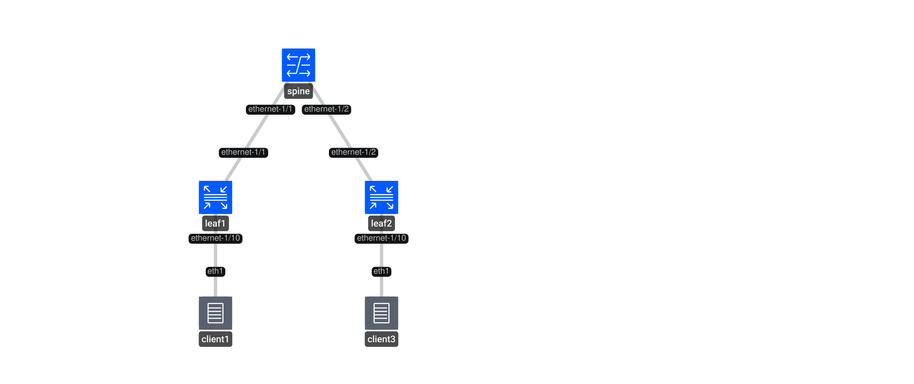

# Mastering gRPC-Based Services for Network Automation

## Section 0: Administrative matters

Welcome to the workshop on *Mastering gRPC-based services for network auotmation* at DENOG 18!

This README is your starting point into the hands on section of this workshop.

You will need a laptop with an SSH client and/or a web browser to fully participate in this workshop.

If you need help, please raise your hand and a Nokia team member will be happy to assist. :)

### Lab Environment

A Nokia team member will provide you a note with your workshop instance ID, and we will also show you the login credentials to your workshop VMs.

Each participant will be provided their own Linux VM to work on during this workshop. Your workshop VMs will be accessible at `<instance ID>.ws.dcf.network`.

The workshop VMs will be accessible through SSH, running on non-standard port 2222, and via a hosted Visual Studio Code instance, on port 8443, available through a web browser.  
The password for the hosted Visual Studio Code instance is the same as the login password.

> [!DANGER]
> Make sure to save your work that you do on the workshop VM!
> We will be tearing them down right after the workshop ends.

If you would like to run the lab on your own system or VM, either during the workshop or on your own time, please make sure you have the following available on a recent Linux system:

- An installation of Docker and Containerlab (a quick start guide can be found [here](https://containerlab.dev/quickstart/)), and ability to deploy Docker containers/Containerlab topologies
- Ability to pull OCI (Docker) images from ghcr.io
- Installations of `gnmic`, `gnoic`, `gnsic` and `gribic`. See the [section below](#grpc-clients) on how to install these gRPC clients

This workshop lab can also be deployed using GitHub Codespaces, as an alternate solution to running it on your own VM. Once you are logged into GitHub, click the below icon and wait for 2 minutes for codespaces to be ready. During this initialization, Codespaces will install Containerlab and gRPC clients so that you are all set to run the use cases immediately.

<div align=center>
<a href="https://codespaces.new/vista-/denog18-grpc-workshop?quickstart=1">
</a>

**[Run](https://codespaces.new/vista-/denog18-grpc-workshop?quickstart=1) this lab in GitHub Codespaces for free**.  
[Learn more](https://containerlab.dev/manual/codespaces/) about Containerlab for Codespaces.

</div>

---

## Workshop
The objective of the hands on section of this workshop is the following:

- Configuring, retrieving state, streaming telemetry using gNMI
- File backup, restore and software upgrade prep using gNOI
- gRPC service authorization and certificate management using gNSI
- Traffic steering using gRIBI

## Lab Topology
Each workshop participant will be working with their own switch topology consisting of 2 leaf and 1 spine switches along with 2 clients. The leaf-spine architecture is typical in a data center environment and clients are simulating workloads or VMs.



## NOS (Network Operating System)

Both leafs and spine nodes in the workshop topology are running release 26.7.1 of Nokia [SR Linux](https://www.nokia.com/networks/ip-networks/service-router-linux-NOS/).  
The workshop focuses on the standards-based gRPC services, so in theory, you might be able to use other network OSes if you later wish to reproduce this workshop with a different network stack.

Both clients in the topology are a light version of [Alpine Linux](https://alpinelinux.org/).

The switches and clients are both pre-configured to allow for basic connectivity - the switches have BGP underlay sessions (distributing loopback routes) and overlay sessions (for EVPN routes) configured, and a MAC-VRF (L2VPN) service allows the two clients to communicate.

See the [topology file](denog18-grpc.clab.yml) for more details.

## Section 1: Getting the workshop ready! 

## Task 0: Deploying the lab

Login to the VM using the credentials on your sheet.

Containerlab is already pre-installed on your VM, but if you are following along at home or on your own Linux system, run the following command to install Containerlab and its dependencies (including Docker):

```bash
curl -sL https://containerlab.dev/setup | sudo -E bash -s "all"
```

> [!TIP]
> If you would like to use Containerlab without sudo, like the output of the installer suggests, you should add your user to this group using the following command:  
> 
> `gpasswd -a <your username here> clab_admins`
> 
> and apply the new group membership to your terminal session using the command
> `newgrp clab_admins` (or log in and out from the SSH session)
>
> **This has already been set up for you on the provided workshop VM!**

Clone the Git repo to your VM:

```
git clone https://github.com/vista-/denog18-grpc-workshop
```

Verify that the Git repo files are now available on your VM.

```
ls -lrt denog18-grpc-workshop/
```

To deploy the lab, run the following:

```
cd denog18-grpc-workshop
sudo clab deploy -t denog18-grpc.clab.yml
```

[Containerlab](https://containerlab.dev/) will deploy the lab and display a table with the list of nodes and their IPs.  
Below is an example output of a successful deploy.

```
╭────────────┬────────────────────────────────────┬─────────┬────────────────────╮
│    Name    │             Kind/Image             │  State  │   IPv4/6 Address   │
├────────────┼────────────────────────────────────┼─────────┼────────────────────┤
│ client1    │ linux                              │ running │ 172.20.20.10       │
│            │ ghcr.io/srl-labs/network-multitool │         │ 2001:172:20:20::10 │
├────────────┼────────────────────────────────────┼─────────┼────────────────────┤
│ client3    │ linux                              │ running │ 172.20.20.12       │
│            │ ghcr.io/srl-labs/network-multitool │         │ 2001:172:20:20::12 │
├────────────┼────────────────────────────────────┼─────────┼────────────────────┤
│ gnmic      │ linux                              │ running │ 172.20.20.6        │
│            │ ghcr.io/openconfig/gnmic:0.49.0    │         │ 2001:172:20:20::6  │
├────────────┼────────────────────────────────────┼─────────┼────────────────────┤
│ grafana    │ linux                              │ running │ 172.20.20.7        │
│            │ grafana/grafana:9.5.2              │         │ 2001:172:20:20::7  │
├────────────┼────────────────────────────────────┼─────────┼────────────────────┤
│ leaf1      │ nokia_srlinux                      │ running │ 172.20.20.2        │
│            │ ghcr.io/nokia/srlinux:26.7.1       │         │ 2001:172:20:20::2  │
├────────────┼────────────────────────────────────┼─────────┼────────────────────┤
│ leaf2      │ nokia_srlinux                      │ running │ 172.20.20.4        │
│            │ ghcr.io/nokia/srlinux:26.7.1       │         │ 2001:172:20:20::4  │
├────────────┼────────────────────────────────────┼─────────┼────────────────────┤
│ prometheus │ linux                              │ running │ 172.20.20.5        │
│            │ prom/prometheus:v2.37.8            │         │ 2001:172:20:20::5  │
├────────────┼────────────────────────────────────┼─────────┼────────────────────┤
│ spine      │ nokia_srlinux                      │ running │ 172.20.20.3        │
│            │ ghcr.io/nokia/srlinux:26.7.1       │         │ 2001:172:20:20::3  │
╰────────────┴────────────────────────────────────┴─────────┴────────────────────╯
```

To display all deployed labs on your VM at any time, use:

```
sudo clab inspect --all
```

## Task 1: Connecting to the devices

Find the nodename or IP address of the device from the above output and then use SSH.

Username: `admin`

Password: `NokiaSrl1!` (the default password for SR Linux deployed in Containerlab)

> [!NOTE]
> Make sure to save your work that you do on the workshop VM!
> We will be tearing them down right after the workshop ends.

```
ssh leaf1
```

To login to the client, identify the client hostname using the `sudo clab inspect --all` command above and then:

```bash
sudo docker exec -it client3 bash
```

### Topology Link Addressing



To derive IPv6 addresses, replace the dots with colons, with the last dot being replaced by two colons. The /31 point-to-points are /127s in the IPv6 addressing plan, while the client subnet is a /64 instead of a /24.

### Task 2: Verify reachability between devices

After the lab is deployed, check reachability between leaf and spine devices using ping.  
In SR Linux, the ping command runs in the management network-instance if otherwise not specified, so the network-instance argument should be set as `default`.

Example on `spine` to `leaf1` for IPv4:

```
ping -c 3 192.168.10.2 network-instance default
```

Example on `spine` to `leaf1` for IPv6:

```
ping6 -c 3 192:168:10::2 network-instance default
```

## gRPC Clients

We will be using the following gRPC clients:

- [gNMIc](https://gnmic.openconfig.net/)
- [gNOIc](https://gnoic.kmrd.dev/)
- [gNSIc](https://github.com/karimra/gnsic)
- [gRIBIc](https://gribic.kmrd.dev/)

All 4 clients are installed by default on the VM provided to you.

Verify that clients are installed on your VM:

```
gnmic version
gnoic version
gnsic version
gribic version
```

If for any reason, one of the above clients needs to be re-installed or updated, refer to the client pages referenced above.

For gNSI client build instructions, refer to the [gnsi-build.sh](gnsi-build.sh) script in this repo.

All `gnmic`, `gnoic`, `gnsic` and `gribic` commands should be executed from the VM, not from the containerized clients!


## Task 3: Enabling gRPC services

Before we get on with the use cases, let's verify the gRPC server configuration on the SR Linux nodes and confirm whether all required gRPC services are enabled.

There are 2 gRPC servers configured on all 3 SR Linux devices - `mgmt` (secure using TLS) and `insecure-mgmt` (not using TLS).

On either leafs or spine, run the following command to display the gRPC configuration for both servers.

```bash
info system grpc-server mgmt
info system grpc-server insecure-mgmt
```

Expected output for secure gRPC server:

```
admin-state enable
    rate-limit 65000
    tls-profile clab-profile
    network-instance mgmt
    trace-options [
        request
        response
        common
    ]
    services [
        gnmi
        gnoi
        gnsi
        gribi
        p4rt
    ]
    unix-socket {
        admin-state enable
    }
```

Expected output for insecure gRPC server:

```
    admin-state enable
    rate-limit 65000
    network-instance mgmt
    port 57401
    trace-options [
        request
        response
        common
    ]
    services [
        gnmi
        gnoi
        gnsi
        gribi
        p4rt
    ]
    unix-socket {
        admin-state enable
    }
```

These have been pre-configured for us by Containerlab - on a production SR Linux device's factory default configuration, the secure `mgmt` gRPC server is present, but not all services are enabled; and the `insecure-mgmt` gRPC server is not present at all.

We can see that all 4 gRPC services for this workshop are enabled on both gRPC servers.

The secure gRPC server is listening on the default gRPC port (57400) while the insecure gRPC server is listening on port 57401.

## Next Section: [gNMI Service](/gnmi/README.md)

--------------------------
## Useful links

* [containerlab](https://containerlab.dev/)
* [gNMIc](https://gnmic.openconfig.net/)
* [gNOIc](https://gnoic.kmrd.dev/)
* [gRIBIc](https://gribic.kmrd.dev//)

### SR Linux
* [SR Linux documentation](https://documentation.nokia.com/srlinux/)
* [Learn SR Linux](https://learn.srlinux.dev/)
* [YANG Browser](https://yangbrowser.nokia.com/srlinux)
* [gNxI Browser](https://gnxi.srlinux.dev/)
* [gNxI Protomaps](https://protomap.netdevops.me/)
